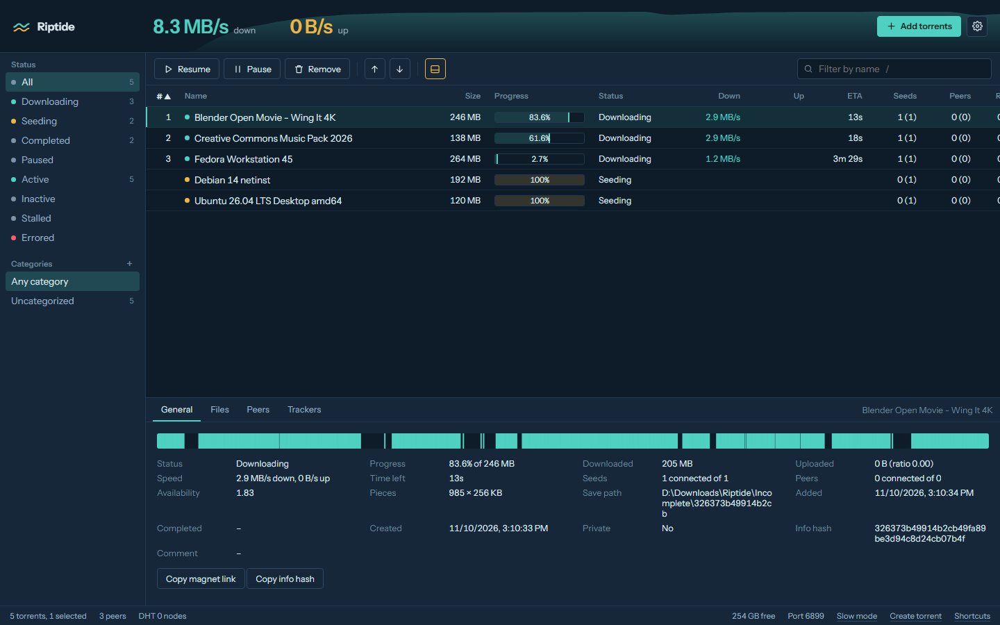

# Riptide



A local-first torrent client with a fast web UI. Built on libtorrent 2.x (BSD-3), the same engine
qBittorrent and Deluge use, with a FastAPI backend and a React interface that runs in your browser.

## Run it

### Windows

Double-click `start.bat` from the repo root. The first run creates a Python 3.13 environment, installs everything
and builds the UI; later runs start in a couple of seconds. The UI opens at http://127.0.0.1:8787.

### Linux and macOS

Needs Python 3.12 or 3.13 and Node.js 20.19 or newer. libtorrent publishes wheels for Linux x86_64 and for
macOS on Apple Silicon (macOS 14 or newer).

```
python3.13 -m venv .venv
.venv/bin/python -m pip install -e backend
(cd web && npm ci && npm run build)
.venv/bin/python -m riptide
```

The UI opens at http://127.0.0.1:8787 (pass `--no-browser` to skip opening it). The tray icon, start with
Windows and the magnet/.torrent handler registration are Windows-only; everything in the web UI works the same.

### Settings

Settings go in `.env` (copy `.env.example`). Every path can be overridden with a `RIPTIDE_*` variable; nothing
assumes a particular drive letter. Defaults:

| | Windows | Linux and macOS |
|---|---|---|
| App data | `%LOCALAPPDATA%\Riptide\data` | `~/.local/share/riptide` (or `$XDG_DATA_HOME/riptide`) |
| Downloads | `%USERPROFILE%\Downloads\Riptide` | `~/Downloads/Riptide` |

Unfinished files go to the `Incomplete` folder inside the downloads folder.

## What works in v0.1.0

- Add by magnet (one or many), by `.torrent` file, drag and drop anywhere, or Ctrl+V a magnet anywhere
- Live table: progress, speeds, ETA, seeds and peers, ratio, queue position; sort, multi-select, keyboard control
- Filters by status, category and tag; name search
- Details: general info with a live piece map, file tree with per-file and per-folder priorities, peers, trackers
- Pause, resume, force start, recheck, reannounce, queue up/down, move data, remove with or without data
- Per-torrent speed limits, sequential download, categories with their own save folders, tags
- Global settings: speed limits, port, UPnP/NAT-PMP, DHT, LSD, uTP, queue limits, encryption, anonymous mode, proxy
- Slow mode (alternative speed limits), create torrents (hybrid v1+v2) and seed them right away
- Export `.torrent`, copy magnet link, desktop notification on finish, dark and light themes
- Resume data survives restarts; state files are written atomically
- Live tide chart of the last 5 minutes of total speed

Planned next: RSS auto-download, search, streaming while downloading, a stall doctor, disk guard, a
qBittorrent-compatible API for Sonarr/Radarr, remote access with login, and a Windows installer.

## Develop

Install the backend with its dev extras (`pip install -e "backend[dev]"`) and run `npm ci` in `web/`, then:

```
python scripts/verify.py          # lint, tests, typecheck, build, license gate, contract check
powershell scripts\start.ps1 -Dev  # Windows: backend on :8787, Vite with hot reload on :5173
python scripts/demo_swarm.py      # local fake swarm for UI work, no internet needed
```

Layout:

```
backend/riptide/engine.py   the only libtorrent user: session, alerts, resume data, snapshots
backend/riptide/app.py      HTTP + WebSocket API (contract: SERVICE_CONTRACTS.md)
backend/riptide/store.py    categories, tags, app settings (JSON, atomic writes)
backend/tests/              end-to-end tests with two real engines over loopback
web/src/                    React UI: store.ts (state), api.ts (all network), components/
scripts/                    verify, license gate, string and i18n checks, demo swarm, smoke download
```

## Licensing

Source available for review. All rights reserved.

Every runtime dependency is permissive (MIT, BSD, Apache, ISC, OFL for the font; certifi is MPL-2.0 and shipped
unmodified). `scripts/check_licenses.py` enforces this on every verify. No code is taken from GPL clients.
